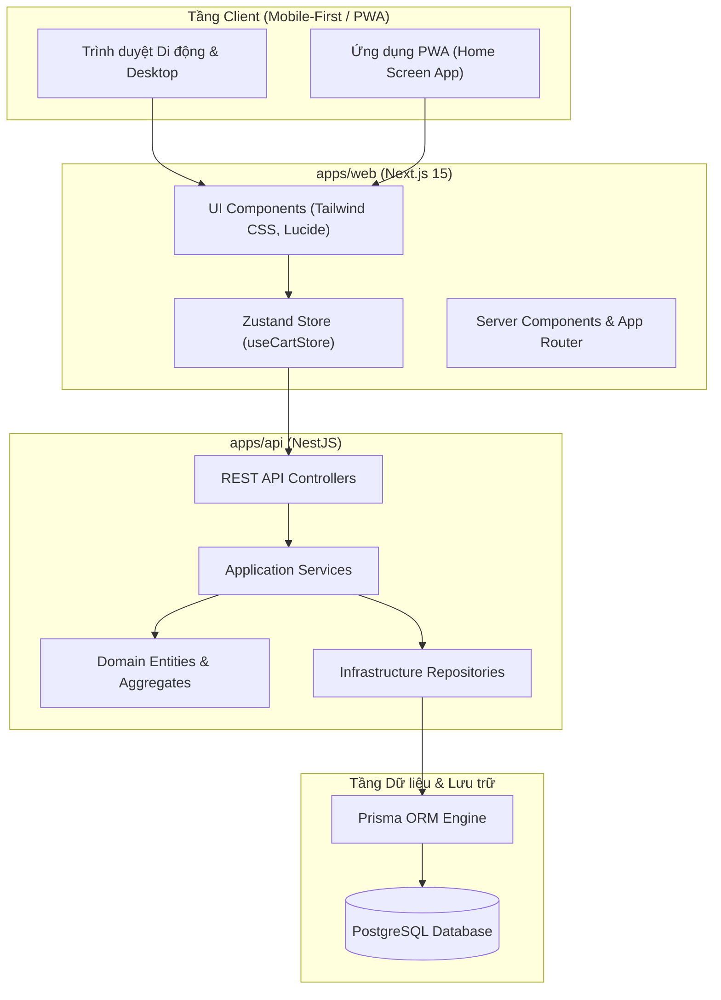

# Task 3: System Architecture & Design — BrewLite

Tài liệu thiết kế kiến trúc toàn diện của nền tảng **BrewLite**, mô tả cấu trúc Monorepo, nguyên lý Clean Architecture / DDD ở Backend và kiến trúc Mobile-First PWA ở Frontend.

---

## 1. Tổng quan kiến trúc Monorepo (High-Level Architecture)

Hệ thống được tổ chức theo mô hình Monorepo hiện đại:



---

## 2. Kiến trúc Clean Architecture / DDD tại `apps/api` (Backend)

Backend tuân thủ nghiêm ngặt mô hình **Clean Architecture** và các nguyên lý **SOLID**:

```text
apps/api/src/cart/
├── domain/                             # Tầng Domain (OOP Core, Không phụ thuộc Framework bên ngoài)
│   ├── cart.entity.ts                  # Aggregate Root 'Cart' bảo vệ các bất biến nghiệp vụ
│   ├── cart-item.entity.ts             # Entity 'CartItem'
│   ├── cart.interface.ts               # Type definitions và interfaces dữ liệu
│   └── cart.repository.interface.ts    # Interface trừu tượng ICartRepository (DIP)
├── dto/                                # Tầng Data Transfer Object
│   ├── add-to-cart.dto.ts              # DTO tiếp nhận dữ liệu thêm vào giỏ
│   └── update-cart-item.dto.ts         # DTO cập nhật số lượng
├── infrastructure/                     # Tầng Infrastructure (Kỹ thuật và cơ sở dữ liệu)
│   └── prisma-cart.repository.ts       # Triển khai cụ thể của ICartRepository dùng Prisma
├── cart.controller.ts                  # Tầng Presentation / Adapter (REST Endpoints)
├── cart.service.ts                     # Tầng Application Service (Điều phối luồng nghiệp vụ)
└── cart.module.ts                      # NestJS Dependency Injection Container
```

### Các nguyên lý áp dụng:
1. **Single Responsibility Principle (SRP):** Từng entity chịu trách nhiệm tính toán logic nội bộ; Controller chỉ tiếp nhận request; Service chỉ điều phối nghiệp vụ.
2. **Dependency Inversion Principle (DIP):** `CartService` phụ thuộc vào interface `ICartRepository`, không phụ thuộc trực tiếp vào `PrismaClient` hay cơ sở dữ liệu cụ thể. Provider được inject thông qua token `CART_REPOSITORY`.
3. **Domain Aggregate Root:** `Cart` quản lý danh sách `CartItem`, đảm bảo tính toàn vẹn (tính tổng tiền, gộp số lượng khi cùng sản phẩm/options).

---

## 3. Kiến trúc Mobile-First PWA tại `apps/web` (Frontend)

Frontend được phát triển với **Next.js** và **Tailwind CSS**, thiết kế ưu tiên thiết bị di động (Mobile-First):

1. **State Management với Zustand (`useCartStore`):**
   - Quản lý trạng thái giỏ hàng tập trung, đồng bộ ngay lập tức với API backend.
   - Hỗ trợ cập nhật lạc quan (Optimistic UI) giúp trải nghiệm đặt hàng mượt mà không có độ trễ.
2. **Badge & Real-time Indicator:**
   - Huy hiệu giỏ hàng tự động cập nhật tổng số lượng item ngay khi thêm món mới.
3. **PWA & Caching:**
   - Hỗ trợ Manifest (`manifest.json`) và Service Worker để người dùng có thể "Add to Home Screen".
   - Bộ nhớ tạm cho thực đơn giúp khách hàng có thể duyệt đồ uống ngay cả khi mạng chập chờn.
