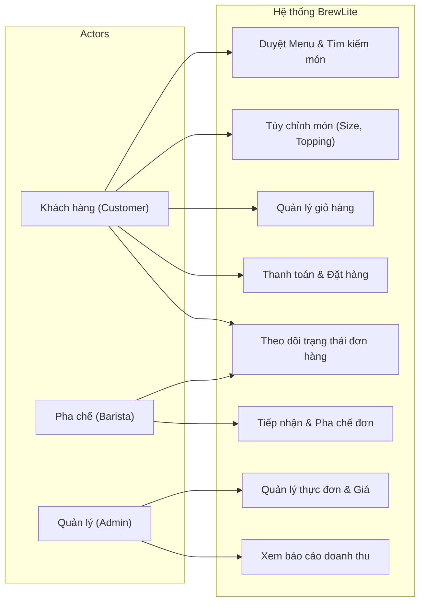
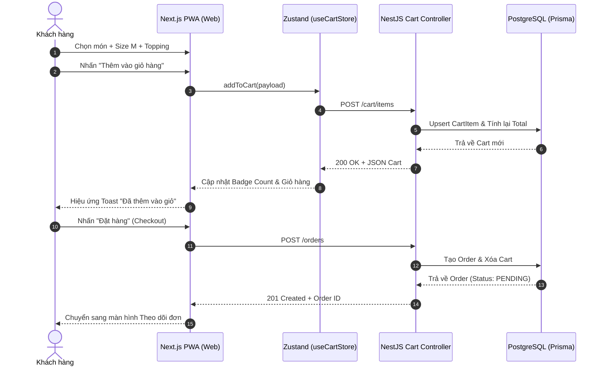
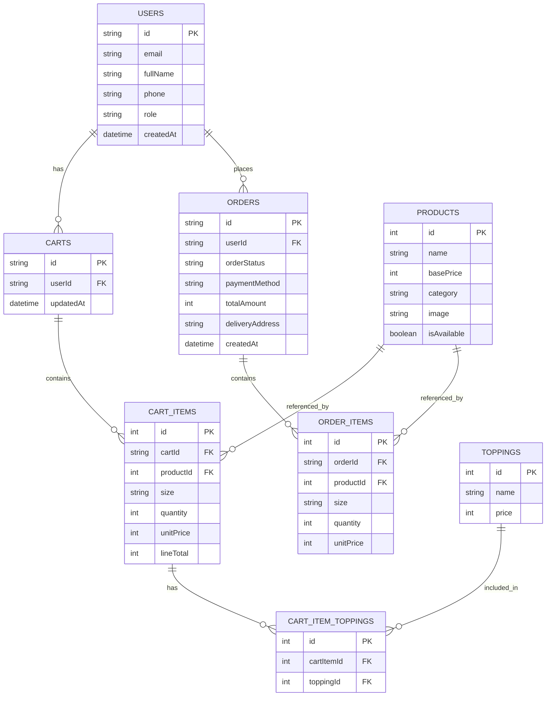
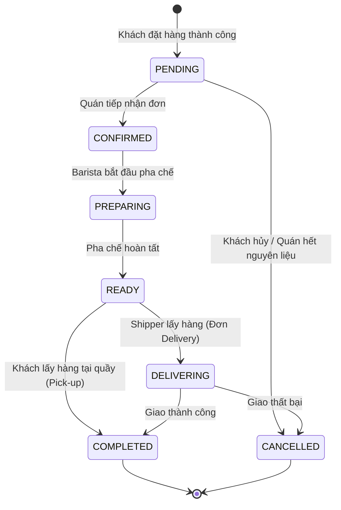

# Task 2: System Diagrams — BrewLite

Tài liệu trực quan hóa kiến trúc và quy trình nghiệp vụ của hệ thống **BrewLite** qua các biểu đồ chuẩn UML và ERD.

---

## 1. Use Case Diagram (Biểu đồ ca sử dụng)

---

## 2. Sequence Diagram: Quy trình Thêm vào giỏ & Đặt hàng

---

## 3. Entity-Relationship Diagram (ERD — Cơ sở dữ liệu)

---

## 4. State Diagram: Vòng đời trạng thái đơn hàng (Order State Machine)

